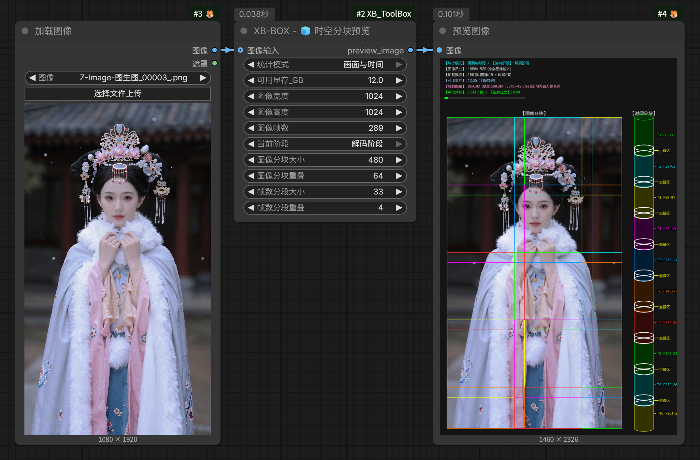
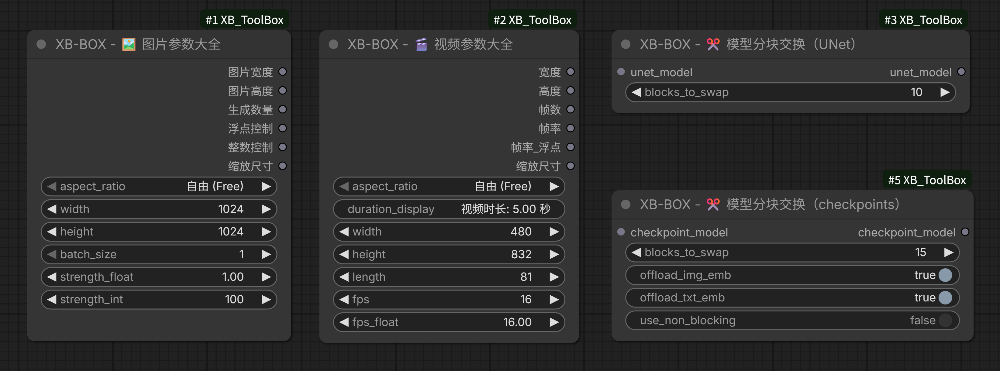
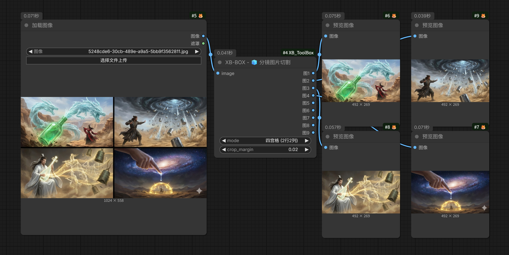
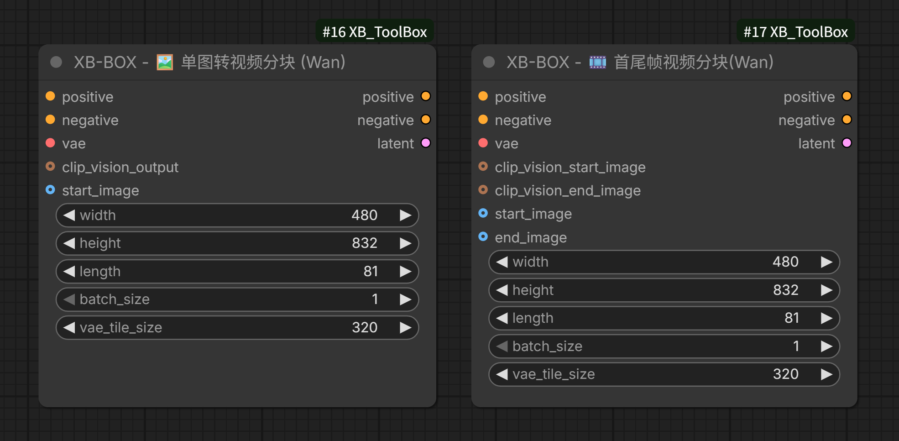
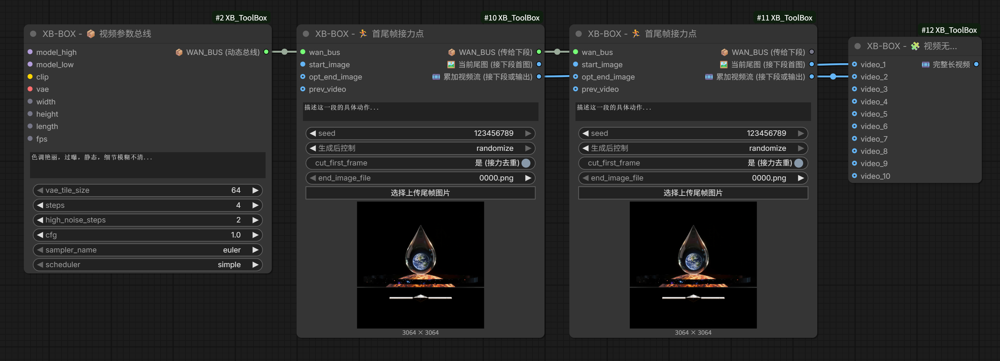
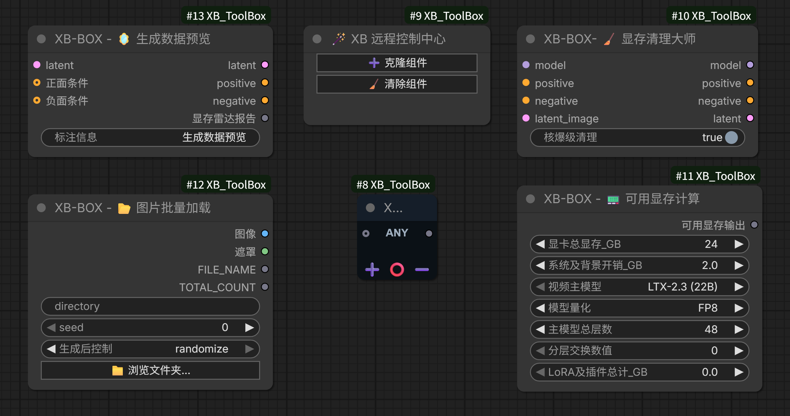

<div align="center">
  🌐 <a href="README.md">English</a> | <a href="README_zh.md">简体中文</a>
</div>
<br>

# 🧰 ComfyUI XB-BOX (XB_ToolBox)

---

## 🌟 Core Philosophy

The primary goal of **XB_ToolBox** is to help AI beginners new to ComfyUI quickly master workflows, making local deployment and execution simpler and more convenient. It is a comprehensive ComfyUI extension suite encompassing both front-end interaction and low-level memory scheduling.

- **Unified Parameters:** Integrates frequently used but scattered parameter nodes, allowing you to set essential image and video parameters from a single hub.
- **Visual Learning:** Provides visual chunking and parameter preview nodes, enabling beginners to intuitively understand the concepts of VAE/Encoder chunks, temporal slicing, and overlap effects.
- **UX Enhancements:** Introduces a user-friendly "Mirror Clone Console" (Dashboard) that clones major operation nodes from complex workflows into a unified, clean, and highly efficient control panel.
- **Extreme VRAM Optimization:** Through "Spatiotemporal Chunk Hijacking", "Dynamic VRAM Offloading for UNet/Checkpoints", and "Deep LiteGraph Customization", it allows consumer-grade GPUs to smoothly run massive 14B~22B 3D-DiT video models that would normally cause instant OOM (Out of Memory).

---










---

## 🗺️ What's inside — 141 nodes

| Area | Nodes | Highlights |
|------|:---:|---|
| 🎛️ Media parameters & I/O | 7 | Image / Video Params Master, Hailuo H3 params, Video Loader & Combine, Master Parameter |
| 🧊 VRAM optimization | 25 | 17 official-node wrappers with tiered cleanup, Block Swap, SageAttention, GGUF loaders V1–V3 |
| 🎬 Long-form video relays | 19 | InfiniteTalk / SCAIL / Wan Animate infinite relays, LTX-2.3 streamer, Video Merger, Storyboard Slicer, Digital-Human params |
| 🎥 Wan node family | 24 | I2V, first/last frame, VACE, Fun, Camera, Phantom, HuMo, SCAIL, Dancer, Sound, InfiniteTalk — all with VAE tiling |
| 🎵 Audio & speech | 15 | Audio Slicer ×4, CosyVoice3 ×10, Play Sound |
| 🧠 Local LLM (XB-llama) | 17 | Loaders, instruct, parameters, prompt enhance / reverse, storyboard, MiniMax H3 presets |
| 🖼️ Image presets | 4 | Image Prompt Preset / Pro, Qwen2.1 preset, ShenBi board |
| 🖼️ Model-specific encoders | 3 | FLUX multi-image, Qwen image-edit (+ Plus) |
| 🎨 Super routers | 2 | Bernini prompt router, K2 style router |
| 🎵 YuE2 music | 5 | Style prompt, lyrics, score workbench, cover prep, transcription intake |
| ✂️ Segmentation | 2 | ONNX human segmentation with a GPU (DirectML) path on AMD |
| 💬 Comic | 3 | Dialogue parser, exact-coordinate text renderer, auto bubble renderer |
| 🧰 Utilities & wiring | 11 | Batch loaders, image scale, list dispatcher, string merge, reference-any, status switch, label, MSR, name broadcasters |
| 📊 Hardware dashboard | 1 | Live VRAM / RAM / CPU / GPU / disk panel |

> Counts are read straight from `NODE_CLASS_MAPPINGS` in `__init__.py`.

---

### ✨ Core Nodes

#### 1. 🎬 Media Parameters & Spatiotemporal Visualization

- **🖼️ Image Parameters Master**: Controls core image generation parameters (Width, Height, Batch Size, Strength) in one place. Enforces safe steps to prevent invalid inputs and automatically aligns dimensions when a fixed aspect ratio is selected.
- **🎬 Video Parameters Master**: Manages Width, Height, Frames, and FPS (Integer/Float). Features a geek-level "Auto-Manual Transmission Engine" that smoothly snaps to official pre-trained "Golden Buckets" (e.g., 480x832, 544x960) and strictly locks the physical frame count to the safe `1+8N` rule. Dynamically displays video duration based on frame rate.
- **🧊 Spatiotemporal Chunk Visualization**: An exclusive dual-zone radar! The 2D left panel visualizes spatial image chunks and overlap values, while the 3D right panel uses a painter's algorithm to render temporal cylinder stacks. Saves beginners from the exhaustion of blind parameter tuning.
- 🧊 **Storyboard Image Slicer:** Offers multiple modes to slice common 4-grid, 6-grid, 9-grid... images all at once and output multiple individual images. This makes image-to-video or start/end frame video generation much more convenient, and is highly effective for creating short dramas.
- **📟 VRAM Calculator & Data Radar**: Predicts VRAM footprint for WAN/LTX models under different quantizations (FP8/GGUF) and weighs tensor volumes with MB-level precision. Significantly reduces trial-and-error costs by helping users choose models fitting their VRAM capacity.

#### 2. 🧊 VRAM Optimization

- **🧊 Official Sampler / VAE Wrappers (17)**: call the official ComfyUI nodes verbatim — dynamic `INPUT_TYPES`, `**kwargs` passthrough, zero changes to the underlying algorithm — and inject a tiered cache cleanup (`不做任何清理` / `单次缓存清理` / `双次缓存清理` / `卸载显存模型`) before each run. Covers `KSampler`, `KSamplerAdvanced`, `SamplerCustom(+Advanced)`, `VAEDecode(+Tiled / TiledImage)`, `VAEEncode(+Tiled / ForInpaint)`, plus legacy `ROCm`-named aliases for old workflows.
- **✂️ Block Swap (UNet / Checkpoint)**: forcibly parks the first N transformer blocks and the text/image embedding layers in system RAM, trading time for space.
- **🧠 SageAttention Accelerator / Sage + Block Swap Duo**: mount the attention-acceleration patch alone (auto / PyTorch SDPA / comfy-kitchen), or combined with physical block swapping in one node.
- **📦 GGUF Model Loaders V1 / V2 / V3**: all-in-one loaders stacking GGUF UNet + GGUF CLIP + LoRA (multi-slot) + VAE + Sage + Block Swap. V2 adds high/low-noise UNet pairs, V3 adds dual CLIP and dual VAE.

#### 3. 🎛️ Workflow Deployment Assistants

- **🎛️ Param Bus & Relay Nodes**: an ultra-compact `AnyType` bus that holds every shared parameter (model, VAE, prompt, size, FPS, cleanup tier) plus a matching relay node that executes one segment and passes the accumulated result on. One node replaces a 10-node subgraph and sets your workflow free from "noodle wire" chaos.
- **🧰 Small tools that save a workflow**: list dispatcher (split one list into N outputs), reference-any (single-select switch over dynamic slots), node status switch (mute/bypass a target node from a boolean), string merge, name broadcasters, canvas label, Play Sound.
- **📊 Mirror panel**: the hardware dashboard clones the numbers you care about into one always-visible strip — see §13.

#### 4. 🎬 Long-form Video Relays

A two-minute talking-head clip will OOM in a single pass on almost any GPU. These nodes split the job into reusable relay hops: a **Param Bus** holds every shared parameter (model, VAE, size, FPS, prompts, cleanup tier) and each **Relay Node** runs one segment (encode → sample → decode → trim → accumulate), then hands the accumulated result to the next hop.

- **🎵 InfiniteTalk Param Bus / Relay** — single speaker, dual speaker, multi-reference, and an all-in-one variant; the bus encodes the audio once and slices it per segment automatically.
- **🏃 Wan Animate Param Bus / Relay** — motion transfer from a driving video, same relay pattern.
- **🆕 SCAIL Param Bus / Relay** — SCAIL pose-driven video relay.
- **🔄 LTX-2.3 Infinite Streamer** — single-sample (8-step) long-form streamer with guide stitching.
- **🎬 Video Merger / Storyboard Slicer / Digital-Human params** — merge clips, slice grid storyboards into panels, and one-stop parameter + audio preparation for digital-human workflows.

#### 5. 🎥 Wan Node Family (24)

Re-implementations of the Wan video nodes with **VAE tiling** built in (spatial + temporal chunking to flatten the decode peak): `ImageToVideo`, `FirstLastFrameToVideo`, `VaceToVideo`, `FunControl` / `FunInpaint`, `Camera`, `PhantomSubject`, `HuMo`, `SoundImageToVideo` (+ Extend), `SCAIL` (+ Pro), `Dancer` (+ Dance Switcher and Dancer Combo), `InfiniteTalkToVideo` (single / dual / legacy mode switch), `Wan22ImageToVideoLatent`, `WanVAEDecodeTiled`.

> These are graph members only — the Wan **model / sampler / VAE / text-encode** nodes come from [ComfyUI-WanVideoWrapper](https://github.com/kijai/ComfyUI-WanVideoWrapper). `XB_WanAnimateToVideo` and `XB_WanCompileSettings` are fully self-contained.

#### 6. 🎵 Audio & Speech (15)

- **🎵 Audio Slicer ×4** — waveform display with draggable cut handles: basic, V1 (single speaker), V2 (two speakers + gap), V3 (advanced, dual-track mixing).
- **🔊 CosyVoice3 ×10** — model loader (auto-download + cache), zero-shot cloning, cross-lingual synthesis, instruct-style control, speaker-preset save / clone, voice conversion, multi-speaker dialog, audio crop. Presets are stored as CosyVoice-compatible `.pt` files, so you never re-upload the reference clip.
- **🔊 Play Sound** — play a notification when a workflow finishes.

#### 7. 🧠 Local LLM Prompt Suite (XB-llama, 17)

Local LLM/VLM inference for prompt work: model loader (+ Pro, which folds every inference parameter into one panel), instruct, reasoning parameters, unload / clean-state, bbox extraction, code-block unpacking, prompt **enhancer**, prompt **reverse** (a five-in-one node: loader + parameters + API settings + preset + instruct), storyboard enhancer / instruct / processor (+ Pro), MiniMax H3 prompt presets (`fl2va`, `ref2va`) and the role/scene dispatcher.

Both a **local model** and an **online API** backend are supported; API keys live in the ComfyUI `user` directory and are never written into the workflow.

#### 8. 🖼️ Image Prompt Presets (4)

- **🖼️ Image Prompt Preset** — one node replacing "prompt box + aspect-ratio node + official empty latent", with step-locked width/height and ratio linking.
- **🖼️ Image Prompt Preset Pro** — the same, plus built-in LLM prompt enhancement / reverse.
- **🖼️ Qwen2.1 Prompt Preset** — preset + element panel, wired to the official Load CLIP + Generate Text chain.
- **🖌️ ShenBi** — an input-less paint board (create / edit modes) that outputs a strictly on-resolution image.

#### 9. 🖼️ Model-specific Encoders (3)

- **FLUX Multi-Image Encode** — resize → VAE encode → ReferenceLatent chained, with image slots auto-expanding up to 9.
- **Qwen Image-Edit Encode (+ Plus)** — ports of the official `TextEncodeQwenImageEdit` / `...Plus`, dynamic image slots up to 9.

#### 10. 🎨 Super Routers (2)

**Bernini Prompt Router** and **K2 Style Router** rewrite heavy multi-switch subgraphs (Fast Muter + Any Switch chains) as a single native node, so the front-end cost of refreshing and dragging drops from O(n) hidden nodes to O(1).

#### 11. ✂️ Segmentation & Comic (5)

- **✂️ Human Segmentation** — ONNX u2net (RMBG-1.4) model loader plus a mask / cutout node, running on the GPU through DirectML on AMD.
- **💬 Comic ×3** — parse dialogue out of a script, render text at exact coordinates, or auto-detect white speech bubbles and fill them in.

#### 12. 🧰 Utilities & Wiring (11)

Batch folder / batch images (muted inputs are skipped), batch image scale (N-in / N-out), list dispatcher, string merge (with a per-segment newline option), reference-any, node status switch, canvas label, MSR multi-image → frame sequence, and UNet / CLIP name broadcasters.

#### 13. 📊 Hardware Dashboard (1)

**XB 📊 Memory Visualization** — a live panel for VRAM / RAM / CPU / GPU / disk / pagefile, with a per-model VRAM breakdown, an aimdo page-residency heatmap, history graphs, themes, and a docked mini-bar that pins to the ComfyUI top bar. Full guide: [docs/XB_MemoryVisualization_manual.md](docs/XB_MemoryVisualization_manual.md).

#### 14. 🎵 YuE2 Music

YuE2 is a white-box song generator: it plans an editable ABC score from style + lyrics, then renders audio from that score. These nodes bring the official skill's symbolic-layer workflow into ComfyUI (the ABC parser is an in-node port of the official bounded-dialect implementation, standard library only, nothing leaves your machine).

- **🎵 YuE2 Style Prompt**: Builds the official six-part `style` string (Language / Genre / Vocal / Tempo / Instruments / Musical Characteristics) with 13 one-click recipes and a genre library. Also exposes `max_duration` and `seed`, so the planner and the renderer share one seed for reproducible plans. Structure, key and meter stay out of `style` — they belong to the lyrics tags and the score.
- **🎵 YuE2 Lyrics**: Section tags with a picker (the official **eight-tag** vocabulary + community spellings + your own `[custom]` tags), a one-click instrumental skeleton, and singability checks (implementation notes leaking into lyrics, round-bracket role labels that get sung, empty sections, per-line syllable counts, and whether a tag is official).
- **🎵 YuE2 Score Workbench**: Inspect / strip chords / move the vocal melody to `Ins` / use an edited score, with the official rule set (grid, `Z2–Z4` compression, chord vocabulary, ties). Emits the processed score plus a readable report whose first line is the mode suggestion (`full` vs `melody`). Note the score carries **no instruments** — set those in the style node. Option names stay short; every explanation lives in the widget tooltip.
- **🎵 YuE2 Transcription Intake**: Reads SheetSage2 output (`score.abc` / `events.json`) from a folder or file, applies the mechanical normalizations from the official repair table (Markdown fences, BOM, curly quotes, `M:C`, `Q:81`, `K:B minor`), validates against the native dialect and emits a usable score. Semantic repairs (unrolling repeats, quantizing tuplets, adding rests) are deliberately left to you, with the official validator's own message shown.
- **🎵 YuE2 Cover Prep**: Builds cover conditions — which voice to keep x how to handle the harmony — and the harmony choice literally sets the downstream mode (chord-free → `melody`, a true cover; keep chords → `full`, closer to a re-record). The report carries the before/after event comparison and the official cover flow. A cover only supplies a symbolic melody; it does not preserve the source singer's identity or waveform.

Requires a ComfyUI build that ships the native `YuE2GenerateABC` / `YuE2GenerateMusic` nodes (bring them in with the official text-to-music workflow). The nodes here only emit STRING/FLOAT/INT, so they load on any build.

**Where each official capability lives** (so nothing is duplicated or missing):

| Official capability | Where it is |
|---|---|
| Planning/rendering parameters — `mode`, `max_abc_tokens`, `temperature`, `top_p`, `top_k`, `repetition_penalty`, `penalty_window`, `cfg_scale` | The official `YuE2GenerateABC` / `YuE2GenerateMusic` nodes. This package only feeds `style` / `max_duration` / `seed` into them. |
| Style, lyrics, section tags | 🎵 YuE2 Style Prompt / 🎵 YuE2 Lyrics (the official eight-tag vocabulary + community spellings + custom tags) |
| ABC inspect / strip chords / move voice / event compile / difference review | 🎵 YuE2 Score Workbench (a port of the official bounded-dialect implementation) |
| Cover conditions (chord-free → `melody`, keep chords → `full`, voice selection) | 🎵 YuE2 Cover Prep |
| Decoder choice (`YuE2-Vae` for listening, `YuE2-Vae-legacy` for benchmark reproduction) | Determined by the VAE you load; re-decoding cached latents needs no new generation. |
| Audio→score transcription (SheetSage2) **itself** | Not here — it needs a separate Python environment (Python 3.10/3.11 + torch 2.8/cu126). Use 🎵 YuE2 Transcription Intake to bring its `score.abc` / `events.json` back into the graph. |
| MERT2 features, `yue2 batch`, the `listen.py` HTML player, SongBench scoring | Not here — they are delivery/evaluation tooling rather than graph nodes. |

Handy official behaviours the nodes surface for you: `off` mode is automatic when the ABC input is empty, a truncated score fails structure validation, `mode=melody` rejects any chord symbol, and the planner and renderer can receive **different** lyrics (section-tags-only for planning, real words for singing).

**Instrumental needs three things, not just a style setting.** The official instrumental entry point (a) prefixes `Instrumental, ` and (b) forces four suppression conditions — `no vocals, no singing, no choir, no spoken words`. The style node now does exactly that when you pick 纯音乐. But style alone cannot remove singing: the score's `Vocal` voice must have **no sounding notes** (Score Workbench → "Vocal to Ins"), and the lyrics must be empty or section tags only (Lyrics node → "纯音乐骨架"). The official docs still say a file check cannot prove the absence of vocal leakage — confirm by listening.

---

### 📦 Installation

**Method 1: ComfyUI Manager (Recommended)**
Search for `XB_ToolBox` in the ComfyUI Manager and click install.

**Method 2: Manual Git Clone**
Navigate to your ComfyUI `custom_nodes` directory and run:

```bash
git clone https://github.com/wjluoxiao/XB_ToolBox.git
```

(Note: the core architecture relies purely on the native ComfyUI ecosystem — elegant Python/JS, no patched libraries. Some node groups do import extra packages; see below.)

#### 🔧 Dependencies

Most nodes are dependency-free, but a few groups import extra packages. Install them all with:

```bash
pip install -r requirements.txt
```

| Node group | Packages |
|---|---|
| Audio slicer, video I/O | `av`, `imageio-ffmpeg` |
| Comic text detection | `easyocr`, `opencv-python` |
| Human segmentation | `onnxruntime` (on AMD use `onnxruntime-directml`) |
| Hardware dashboard | `psutil`, `pythonnet` (bundles `LibreHardwareMonitorLib.dll`) |
| Local LLM (XB-llama) | `diskcache`, `gguf`, and **`llama-cpp-python`** — install that one manually to match your GPU |
| CosyVoice3 | `modelscope`, `huggingface_hub`, `transformers`, `librosa`, `soundfile`, `HyperPyYAML`, `omegaconf`, `hydra-core`, `conformer`, `openai-whisper`, `tiktoken`, `scipy`, `einops`, … |
| Audio waveform endpoint | `aiohttp` |

**Optional companion extensions** — a few groups expect these to be installed:

| Feature | Needs |
|---|---|
| Wan nodes & relay pipelines | [ComfyUI-WanVideoWrapper](https://github.com/kijai/ComfyUI-WanVideoWrapper) — supplies the Wan model loader / sampler / VAE / text-encode nodes |
| GGUF model loaders | [ComfyUI-GGUF](https://github.com/city96/ComfyUI-GGUF) |
| YuE2 preset nodes | A ComfyUI build that ships `YuE2GenerateABC` / `YuE2GenerateMusic` |

Nodes that are fully self-contained say so in their own docstring.

---

### 🙏 Credits

XB_ToolBox stands on the shoulders of the ComfyUI ecosystem. Several nodes are ports, wrappers or adaptations — thanks to their authors:

- **VideoHelperSuite (VHS)** — the video loader/combine and audio-slicing logic derive from VHS.
- **rgthree-comfy** — `XB_ReferenceAny` fuses Fast Muter + Any Switch.
- **ComfyUI-KJNodes** — `XB_StringMerge` is reworked from `JoinStringMulti`; the SageAttention node keeps the original KJNodes design.
- **ComfyUI-Custom-Scripts (pysssss)** — `XB_PlaySound` is an independent re-implementation.
- **ComfyUI-GGUF (city96)** — the GGUF loaders wrap its official nodes.
- **ComfyUI-WanVideoWrapper (kijai)** — companion extension for the Wan family.
- **ComfyUI-MemoryVisualization (kijai)** — the hardware panel started from this project and has since grown its own themes, docking and metrics.
- **ComfyUI-llama-cpp_vlm** — the `XB-llama` nodes are adapted from it.
- `XB_KSampler` and friends call the **official ComfyUI nodes** verbatim and only add cache cleanup.

---

📝 License
This project is open-sourced under the Apache-2.0 License. It guarantees the freedom to share while protecting the patent defense rights of the core architecture code.

---